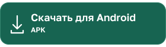
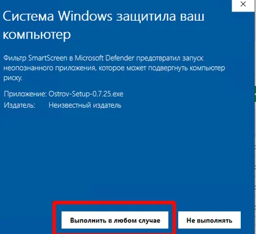

# Остров

Остров - браузер, который  организует безопасный доступ к российским сайтам. Безопасный для вас и вашего устройства.

Работает в песочнице, на борту сертификаты Минцифры и весёлый бывалый попуга Боцман, который шарит за безопасность и готов делиться знаниями.

## Скачать тестовую версию

<!-- downloads:start -->

<!-- downloads:end -->

| Устройство | Версия | Изменения |
|---|---|---|
| Windows 10/11, x64 | 0.7.25 | [Что изменилось](https://github.com/just-trust-digital/Ostrov.Browser/releases/tag/v0.7.25) |
| Android 8.0 и новее | 0.8.0-dev3 | [Что изменилось](https://github.com/just-trust-digital/Ostrov.Browser/releases/tag/android-v0.8.0-dev3) |

Это предварительные версии. Возможны ошибки; проверку приватности Android ещё не завершили. Версии двух платформ развиваются независимо.

### Windows

Закройте Остров и запустите установщик. Приложение устанавливается для текущего пользователя. Если WebView2 отсутствует, установщик загрузит его с сайта Microsoft; потребуется интернет.

#### Если Windows блокирует запуск

Установщик пока не подписан цифровой подписью. Windows может показать предупреждение SmartScreen «Система Windows защитила ваш компьютер» и указать «Неизвестный издатель».

Если вы скачали файл из [официальных выпусков Острова](https://github.com/just-trust-digital/Ostrov.Browser/releases) и доверяете ему:

1. Нажмите **«Подробнее»**.
2. Нажмите **«Выполнить в любом случае»**, чтобы запустить установку.

### Android

Скачайте APK и разрешите установку из выбранного источника. Обновите Android System WebView. Пакет подписан тестовым ключом, поддерживает сертификаты НУЦ. Это экспериментальная версия; совместимость с отдельными сайтами требует проверки. Камера и микрофон, расширения, прокси и автозаполнение паролей пока недоступны.

[История всех версий](CHANGELOG.md).

## Сообщить об ошибке

[Создайте обращение](https://github.com/just-trust-digital/Ostrov.Browser/issues/new): укажите Windows или Android, версию Острова, версию ОС и шаги повтора. Для Android добавьте модель устройства. Опишите ожидаемый результат и то, что произошло.

Обращения видны всем. Не прикладывайте пароли, переписку, личные документы или снимки с персональными данными.

## Проверить файл

В каждом релизе есть `SHA256SUMS.txt`. В PowerShell выполните `Get-FileHash -Algorithm SHA256 <путь-к-файлу>` и сравните результат с контрольной суммой в релизе.

В этом репозитории размещены установщики, инструкции и обращения пользователей.
